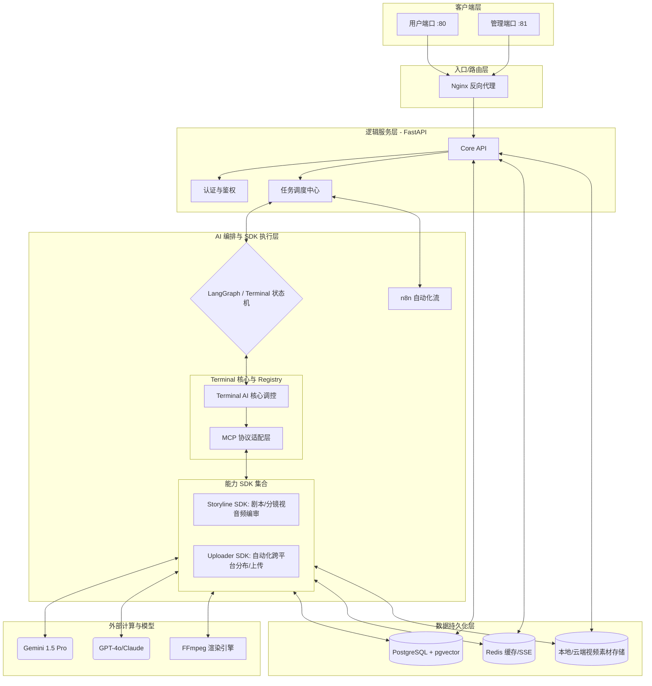

# AgentOS Enterprise — AI 视频全链路自动化剪辑系统（集成 AgentOs-OpenStoryline）

## 📝 项目概述

AgentOS Enterprise 是一款企业级 AI 自动化视频剪辑系统。它利用多模态大模型深度理解视频内容，结合 LangGraph 状态机与 n8n 工作流，实现从“素材分析 → 创意脚本 → 音频生产 → 自动剪辑渲染 → 分发”的全链路自动化生产。

项目专为 B2B 企业设计，旨在将海量原始拍摄素材快速转化为高质量的营销短视频。

---

## ✨ 核心特性与项目亮点

### 🧠 AI-Native "Terminal+SDK" 全新架构
项目率先采用了 **“中心大盘 (Terminal Hub) + 插件能力 (SDK)”** 的解耦设计。这意味着系统的“大脑”能动态识别和调用底层的各类工具集（如 Storyline 或 Uploader），极大提升了业务的扩展速度和系统的稳定性，彻底告别硬编码的复杂逻辑。

### 🔌 深度集成 MCP 模型上下文协议
全链路适配 **Anthropic MCP (Model Context Protocol)** 协议。大模型通过该协议不再只是生成文本，而是能直接、安全地“操作”外部 SDK 进行视频裁剪、配音合成及一键发布。这使得系统在面对未来爆发式增长的 AI 工具生态时，具备了原生的兼容能力。

### 🎬 全链路工业化视频生产流
从视觉素材的 **RAG 语义特征提取**，到创意脚本的 **自动编剧**，再到 **TTS 语音/背景音毫秒级对齐锁合**，最后由 **FFmpeg 分布式异步引擎** 渲染出片。全流程无需人工介入，实现真正的“全自动流水线”。

### 📈 社交媒体矩阵自动化分发
内置针对小红书等主流平台的 **自动发布 SDK**。集成了无头浏览器、自动验证码识别及发布文案的 SEO 优化建议。支持单条视频一键推广到多个 B/C 端账号，助力企业快速捕获公域流量。

### 🛡️ 企业级中控台与 Human-in-the-Loop
独有的 **管理员后端终台 (Admin Console)** 提供全方位的状态监控（SSE 实时流）、资源 ROI 分析及人工审核干预接口（Interrupt）。这对于需要精准把控内容质量的企业用户来说，既保证了自动化的高效，又提供了最后一道质量防线。

---
## 🚀 核心架构

项目采用前后端分离架构，全程基于 **Docker** 容器化部署，确保环境一致性与横向扩展能力。

### 核心架构与技术栈

**前端技术**
- React 19 (基于 Vite 的极速构建)
- TypeScript (类型安全保证)
- Tailwind CSS (原子化响应式布局)
- Framer Motion (精细化动画交互效果)
- Matx (响应式的 Material Design 风格组件库)

**后端技术**
- FastAPI & Python 3.11+ (支持千万级并发请求的核心 API 层)
- Uvicorn (高性能 ASGI 服务器)
- LangGraph (Agent 核心状态机与有向图编排)
- n8n (强大的工作流可视化流转中心)
- AgentOs-OpenStoryline（多模态编剧与分镜生成引擎，基于 OpenStoryline）
- OpenAI 兼容层 (统一的多模型网关，无缝切换 Gemini 1.5 Pro, GPT-4o, Claude 等)
- FFmpeg (底层的海量高并发异步音视频渲染引擎)

**数据库**
- PostgreSQL 15 + pgvector (主数据库，同时作为检索增强 RAG 与长尾视频特征的向量数据库)
- Redis 7 (承担 SSE WebSocket 数据流推送通道及分布式缓存任务)

**基础设施**
- Nginx (反向代理，流量转发网关以及下载素材和静态文件的高可用支持)
- Docker (保障全链路服务、插件容器化的一键部署)

---

### 🏢 后端终台的作用 (Admin Console)

后端终台（管理端口 `:81`）是整个企业级 AI 系统的“指挥大基座”与资源调度大盘，其核心作用包括：
1. **全局控制层与 RBAC 安全体系**：统一管理多权限级别用户（超级管理员、普通用户、只读用户）并监控全节点磁盘消耗和资产容量。
2. **多 Agent 流水线与集群监控**：通过工作概览（Dashboard）实时监控各个独立 AI 节点的存活状态（就绪/运行/离线），根据系统负载、并发和时间分配不同工作流任务。
3. **AI 技能 (Skills) 与知识库 (RAG) 抽屉式管理**：负责拓展、注册及启用系统的技能卡组件（各个平台的自动化推送/采集）与知识沉淀。
4. **工作流程 (Workflows) 与生命周期管控**：深度管理每个节点的拦截机制、人工审核介入与事件编排。集成 SSE 流式状态监听能力，使得工作流每一步（失败/完成）对运营人员绝对可视。
5. **系统健康监控与商业报表 (Reports)**：按全局输出 ROI 统计指标、成本节省报表与全网自动化生产工时估算，支持离线 CSV/PDF 导出功能，帮助核心团队掌握系统的投入产出率。

### 🎬 自动剪辑视频与分发模块

此模块属于高可用生产流水线中的 `Node 04 (Auto-NLE)` 与 `Node 05 (Social Publisher)`，也是将脚本资产实现商业闭环的最后核心步骤：

1. **自动渲染与剪辑控制协议 (Auto-NLE)**
   - **基于时间戳与协议矩阵驱动**：彻底摆脱传统人工剪映软件，全面依托上方 AI 生成的时间轴/分镜说明以及生成式 TTS 语音文件及 BGM 节点，将其自动包装为无缝剪辑协议命令。
   - **自动化无损成片**：底层挂载企业级并发能力的 FFmpeg。完成毫秒级的非线性裁剪、音视频融合、图片/弹幕嵌入合成作业，合成后一键下刷到特定存储云或本地，并自动通过消息中心知告。

2. **社交媒体一键矩阵分发流水线 (Social Publisher)**
   - **社交平台适配驱动器**：系统可内聚自研社交分发 SDK（如小红书无头浏览器自动上粉及授权验证）。
   - **全自动化铺张推流**：针对不同平台特性生成对应的传播文案与热门标签（SEO），并将刚才渲染完的热切视频通过该矩阵协议直推到不同 B 端/C 端分发号，以“高频低成本”进行公域平台流量捕获。

---

### 🛠️ 系统架构图



---

## 🤖 AI 核心架构设计：Terminal 大脑 + 独立 SDK 库

系统经过架构重构，已摒弃了“硬编码的多独立 Agent 流水线”节点设计，全面升级为 **“AI Terminal 智能中枢 + 可插拔式工具 SDK”** 的弹性统一架构。

### 1. Terminal 核心中枢 (Terminal Hub)
*   **智能调度总线**：作为系统唯一的调度“大脑”，统一接收所有来自管理后台与客户端的任务委托。
*   **MCP（模型上下文协议）适配层**：基于先进的动态上下文协议能力，大模型（如 Gemini 1.5 Pro）不仅能“思考”，还能依靠 MCP 高效挂载、检索及呼叫底层的具体执行功能，并能向前端实时反馈状态流（SSE）。

### 2. 功能插件层 (Functional SDKs)
我们将复杂的垂直功能拆解为高度复用且解耦的业务 SDK，当前项目已实装两个核心 SDK 集：
*   **Storyline SDK（全链路视频处理 SDK）**
    *   **职责范围**：全面封装了原先由多个零散节点（视觉读图、脚本撰写、素材对齐、自动剪辑）负责的影像合成工作流。
    *   **底层支撑**：通过 AgentOs-OpenStoryline 与 FFmpeg 协议簇，对音画资源进行统一调度和自动化渲染出片。
*   **Uploader SDK（自动化渠道分发 SDK）**
    *   **职责范围**：针对最终营销成片以及配套文案、TAG进行多套自动化渠道发布分发的执行器集。
    *   **平台适配**：目前已深度集成了支持“无头浏览器自动化登录与管理”的小红书批量发布能力。

### 🚀 架构代差优势
*   **不再设限的灵活性**：系统不再被强制捆绑在“1->2...->5”的线性工作流中。对于颗粒度极细的任务请求（例如：“帮我对素材里的视频调个色或者换个背景音乐”），Terminal AI 可以自由抽取 SDK 解决。
*   **即插即用的全模块化体验**：若未来需要增设“B站视频发布支持”或“AI音效合成模块”，只需新增或扩展对应 SDK 分支即可，主调度后台业务代码零感侵入。

---

## 🖥️ 端口访问指南

项目启动后，可以通过以下端口访问不同服务：

| 门户 | 访问地址 | 说明 |
|:---|:---|:---|
| **用户端口 (User Portal)** | `http://localhost:80` | 素材上传、任务创建、结果预览 |
| **管理端口 (Admin Portal)** | `http://localhost:81` | 节点监控、系统日志、工作流编排 |
| **后端 API (Backend)** | `http://localhost:8000` | FastAPI 服务入口（认证、Storyline 桥接等） |
| **API 文档 (Swagger)** | `http://localhost:8000/docs` | 接口调试与说明 |
| **Uploader 服务** | `http://localhost:8002` | 分发/扫码登录等（浏览器自动化）；用户端经 Nginx 同域 `/api/admin/uploader/` 转发 |
| **工作流引擎 (n8n)** | `http://localhost:5678` | 默认 compose **未启用**（见 `docker-compose.yml` 注释块）；启用后可用 |
| **OpenStoryline** | `http://localhost:7860` | AgentOs-OpenStoryline Web |
| **OpenStoryline API** | `http://localhost:8001` | AgentOs-OpenStoryline API |
| **PostgreSQL** | `localhost:5432` | 数据库（pgvector） |
| **Redis** | `localhost:6379` | SSE/缓存（内部服务使用为主） |

---

## 🛠️ 快速启动

### 1. 克隆项目
```bash
git clone https://github.com/NGU-forever/Eric_Frank.git
cd Eric_Frank
```

### 2. 环境配置
复制 `.env.example` 并重命名为 `.env`，按需填入模型/工作流等密钥。**未创建 `.env` 时 `docker compose` 会因缺少 env 文件而失败**，请先执行：

```bash
cp .env.example .env
```

如果你要在本地运行前端（非 Docker Nginx），也可参考 `frontend/.env.example` 配置前端环境变量。

**默认 Compose 已按生产/交付配置**：`web` 使用镜像内代码（不挂载 `./backend`）、`DEV_MODE=false`（无 Uvicorn 热重载）。客户或生产环境请修改 seed 中的默认管理员密码与 `.env` 中的 `SECRET_KEY`。

**本地开发（后端与 uploader 热重载）**：叠加开发覆盖文件，将 `web` 与 `uploader` 的源码挂载进容器并启用 `--reload`（见 `docker-compose.dev.yml`）：

```bash
docker compose -f docker-compose.yml -f docker-compose.dev.yml up -d --build
```

### 3. 一键部署 (Docker Compose)
```bash
# 生产/交付：构建并后台运行所有服务（默认）
docker compose up -d --build
```

首次启动时 `web`（后端）容器会自动执行：
- 初始化表结构/迁移
- 初始化用户与示例数据（seed）
- 将 SDK 里的 `SKILL.md` 同步进数据库（失败不会阻塞启动）

如需关闭自动初始化/seed，可通过环境变量控制：
- `RUN_DB_INIT=false` 跳过建表/迁移
- `RUN_DB_SEED=false` 跳过 seed
- `RUN_SKILL_SYNC=false` 跳过 SKILL 同步

**安全加固（可选）**：若不需要从宿主机直连 PostgreSQL / Redis，可在部署用的 compose 中移除 `db`、`redis` 服务的 `ports` 映射，使二者仅在内网（容器网络）中可达。

### 4. 账号登录
系统预设超级管理员：
- **账号**: `root@agentos.io`
- **密码**: `ChangeMe!Root@2026`

- **账号**: `admin@agentos.io`
- **密码**: `ChangeMe!Admin@2026`

系统同时预设普通用户：
- **账号**: `user@agentos.io`
- **密码**: `ChangeMe!User@2026`

说明：
- 在用户端（80）输入 `admin@agentos.io`（或 `admin`）会自动跳转到管理端（81）登录。

### 5. 前端开发模式（可选）
若需要前端热更新（Vite），在宿主机单独启动（与上述 Docker 中的 API、数据库等配合使用）：

```bash
cd frontend && npm install && npm run dev
```

`vite.config.ts` 已将 `/api/admin/uploader` 代理到 **`http://localhost:8002`**（独立 uploader 进程），其余 `/api` 仍代理到 `8000`。本地请同时启动主 API 与 uploader，例如：

**说明**：源码目录为 `AgentOs-Uploader/`，但 Python 包名仍为 `uploader`。在仓库根目录执行一次 `ln -sfn AgentOs-Uploader uploader` 后，即可用下方 `PYTHONPATH=backend:.` 启动（Windows 可改用 `docker compose` 或自行配置等价 `PYTHONPATH`）。

```bash
# 终端 1：主 API
cd backend && PYTHONPATH=. uvicorn src.main:app --reload --port 8000

# 终端 2：uploader（仓库根目录；若刚从终端 1 的 backend 目录出发可先 cd ..）
cd .. && PYTHONPATH=backend:. uvicorn uploader.main:app --reload --port 8002
```

后端若需同步热重载，请使用上文「环境配置」中的 `docker-compose.dev.yml` 组合命令；当前仓库的 `docker-compose.yml` 中未定义 `frontend-dev` 服务。

---

## 📁 目录指南
- `/frontend`: React 前端（用户端/管理端同仓构建，Nginx 分别在 80/81 提供服务）。
- `/backend`: FastAPI 核心逻辑、Agent/Skills、数据库与任务路由等。
- `/AgentOs-Uploader`: 社媒分发（抖音/视频号/小红书）独立 Python 包与镜像；compose 服务名仍为 `uploader`，容器内路径 `/app/uploader`。本地开发可在根目录创建符号链接 `uploader` → `AgentOs-Uploader` 以便 `import uploader`。
- `/AgentOs-OpenStoryline`: OpenStoryline 服务（脚本/分镜生成），在 compose 中以 `storyline` 运行。
- `/storage`: 运行期存储（如 `storage/exports` 供前端下载成片；`storage/openstoryline` 供 storyline 输出；`storage/uploader` 供分发模块 cookies/待传视频，需与 `web`、`uploader` 容器挂载同一目录）。
- `/docs/plans`: 设计/方案文档。
- `/n8n_templates`: n8n 工作流模板。

---