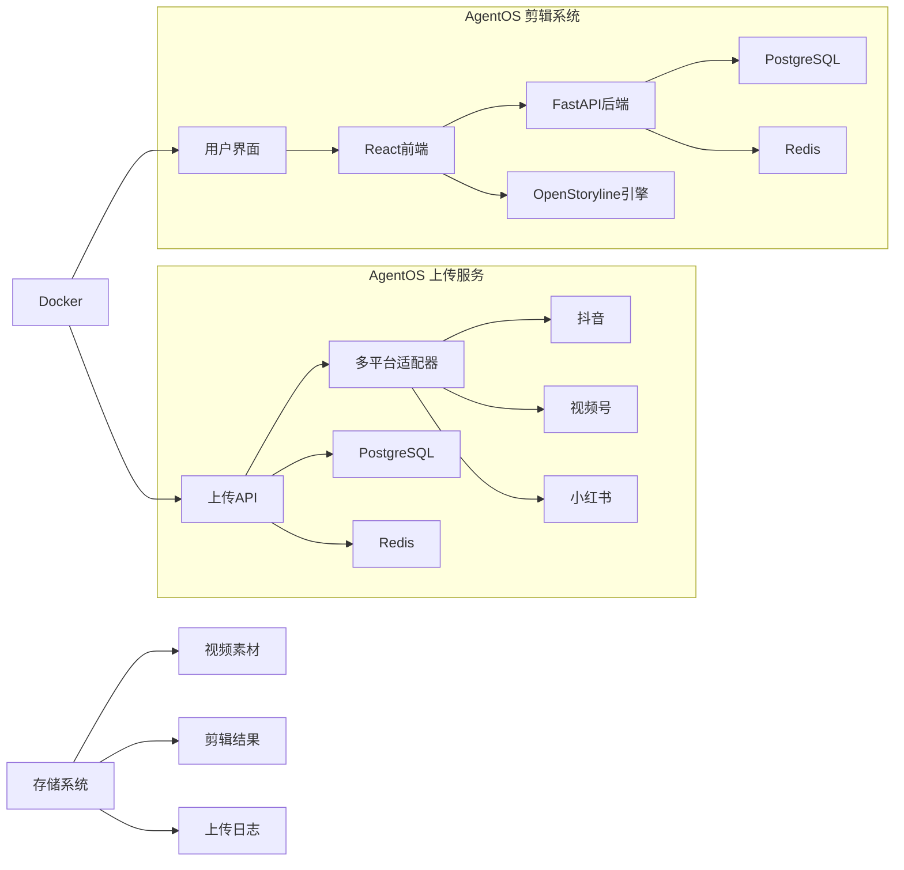

# AgentOS — AI 视频自动化剪辑与发布系统

> 一站式AI视频自动化解决方案：从智能剪辑到多平台自动发布，让视频内容创作和分发自动化。

[](https://www.python.org/downloads/)
[](https://nodejs.org/)
[](https://www.docker.com/)
[](https://opensource.org/licenses/MIT)

## 📝 项目概述

AgentOS 是一个完整的AI视频自动化解决方案，包含两个核心子系统：

1. **AgentOS - AI视频自动化剪辑系统**：基于OpenStoryline的智能视频剪辑平台
2. **AgentOS Uploader - 视频自动上传服务**：支持多平台（抖音、视频号、小红书）的自动化视频发布

通过前后端分离架构和容器化部署，AgentOS 提供从视频素材处理到多平台发布的全流程自动化解决方案。

## 🏗️ 系统架构

### 整体架构图

```
+-------------------+     +-------------------+     +-------------------+
|  AgentOS Frontend | <-> |   AgentOS Backend | <-> |  OpenStoryline    |
| (React + Vite)    |     | (FastAPI)         |     | (Video Editor)    |
+-------------------+     +-------------------+     +-------------------+
         |                        |                        |
         |                        |                        |
         v                        v                        v
+-------------------+     +-------------------+     +-------------------+
|  AgentOS Uploader | <-> |   PostgreSQL      | <-> |   Redis           |
| (Python + FastAPI) |     | (Database)        |     | (Cache)           |
+-------------------+     +-------------------+     +-------------------+
```



### 子系统关系

- **AgentOS 剪辑系统**：负责视频智能剪辑和用户管理
- **AgentOS Uploader**：负责视频多平台自动发布
- **数据共享**：两个子系统共享同一PostgreSQL数据库和Redis缓存
- **前端集成**：通过微前端架构在同一界面中展示两个系统的功能

## ✨ 核心特性

### 🎬 AI视频剪辑

- **智能剪辑**：基于OpenStoryline的AI驱动视频编辑
- **多格式支持**：支持各种视频格式的智能处理
- **实时预览**：剪辑过程实时预览和进度监控
- **模板系统**：可配置的剪辑模板和预设

### 📱 多平台自动发布

- **平台支持**：抖音、视频号、小红书等主流平台
- **账号管理**：多账号统一管理和状态监控
- **会话持久化**：浏览器会话管理和Cookie自动续期
- **任务队列**：智能任务调度和并发控制

### 🔐 统一用户管理

- **单点登录**：统一的认证和授权系统
- **角色控制**：基于RBAC的权限管理
- **数据隔离**：用户数据和任务的隔离管理

### 🚀 容器化部署

- **Docker Compose**：一键部署整个系统
- **微服务架构**：各组件独立部署和扩展
- **数据持久化**：自动化的数据备份和恢复

## 🚀 技术栈

### 核心技术

- **后端**：FastAPI (Python 3.11+)
- **前端**：React 19 + TypeScript + Vite
- **数据库**：PostgreSQL 15
- **缓存**：Redis 7+
- **视频编辑**：OpenStoryline
- **自动化**：Playwright + Celery

### 基础设施

- **容器化**：Docker + Docker Compose
- **反向代理**：Nginx
- **任务队列**：Celery
- **实时通信**：WebSocket + SSE

## 🏢 系统组件

### 1. AgentOS 剪辑系统

- **前端**：React + TypeScript + Vite
- **后端**：FastAPI (认证 + 用户管理)
- **视频编辑**：OpenStoryline (:7860/:8001)
- **端口**：80 (用户端), 81 (管理端), 8000 (API)

### 2. AgentOS Uploader

- **技术栈**：Python 3.8+ + FastAPI + Playwright
- **端口**：8002 (API)
- **功能**：多平台视频自动上传
- **依赖**：PostgreSQL, Redis

### 3. 共享组件

- **数据库**：PostgreSQL (用户数据 + 上传任务)
- **缓存**：Redis (会话管理和任务队列)
- **存储**：本地存储系统

## 🖥️ 端口访问指南

| 服务 | 访问地址 | 说明 |
|:---|:---|:---|
| **用户前端** | `http://localhost` | 用户 dashboard (端口 80) |
| **管理后台** | `http://localhost:81` | 管理界面 (端口 81) |
| **后端API** | `http://localhost:8000` | FastAPI 服务 (端口 8000) |
| **API文档** | `http://localhost:8000/docs` | Swagger 接口文档 |
| **视频剪辑引擎** | `http://localhost:7860` | OpenStoryline Web界面 |
| **剪辑API** | `http://localhost:8001` | OpenStoryline API |
| **上传服务** | `http://localhost:8002` | 视频上传API (端口 8002) |
| **数据库** | `localhost:5432` | PostgreSQL 数据库 |
| **Redis** | `localhost:6379` | Redis 缓存服务 |

## 🛠️ 快速启动

### 1. 克隆项目

```bash
git clone https://github.com/NGU-forever/Ai_Autoclip_System.git
cd Ai_Autoclip_System
```

### 2. 环境配置

复制环境变量模板并配置：

```bash
cp .env.example .env
nano .env
```

### 3. 一键部署

```bash
# 生产环境部署
docker compose up -d --build

# 本地开发（热重载）
docker compose -f docker-compose.yml -f docker-compose.dev.yml up -d --build
```

### 4. 账号登录

系统预设账号：

```bash
# 管理员账号
root@agentos.io / ChangeMe!Root@2026
admin@agentos.io / ChangeMe!Admin@2026

# 普通用户
user@agentos.io / ChangeMe!User@2026
viewer@agentos.io / ChangeMe!Viewer@2026
```

## 📁 项目结构

```
Ai_Autoclip_System/
├── /frontend/              # React前端（用户端/管理端）
│   ├── /src/              # 前端源码
│   └── Dockerfile         # 前端Docker配置
├── /backend/              # FastAPI后端（认证+用户管理）
│   ├── /src/              # 后端源码
│   ├── /scripts/          # 数据库初始化脚本
│   └── /tests/            # 测试文件
├── /AgentOs-OpenStoryline/ # OpenStoryline视频剪辑引擎
├── /AgentOs-Uploader/     # 视频自动上传服务
│   ├── /src/              # 上传服务源码
│   ├── /persistent_browser_service.py # 浏览器会话管理
│   └── /qr_login_service.py # 二维码登录服务
├── /storage/              # 运行期存储
│   ├── /exports/          # 视频成片输出
│   ├── /openstoryline/    # OpenStoryline工作目录
│   └── /raw/             # 原始素材上传
├── docker-compose.yml     # Docker编排配置
└── .env                   # 环境变量配置
```

## 🔌 API概览

### AgentOS 剪辑系统API

- `POST /api/admin/auth/login` - 用户登录
- `GET /api/users` - 获取用户列表
- `POST /api/users` - 创建用户

### AgentOS Uploader API

- `GET /uploader/accounts` - 获取账号列表
- `POST /uploader/accounts` - 添加账号
- `POST /uploader/publish` - 发布视频
- `GET /uploader/tasks` - 获取任务列表
- `POST /uploader/qr-login` - 创建登录任务

### WebSocket实时通知

- `ws://localhost:8002/ws/status` - 上传状态实时通知

## 🔗 系统集成

### OpenStoryline 集成

前端直接调用OpenStoryline API进行视频剪辑：

```typescript
// 前端配置示例
const OPENSTORYLINE_API = 'http://localhost:8001'

// 创建剪辑会话
POST http://localhost:8001/sessions

// 执行剪辑节点
POST http://localhost:8001/sessions/{id}/execute

// 获取进度流
GET http://localhost:8001/sessions/{id}/stream
```

### 微前端架构

AgentOS采用微前端架构，在同一界面中集成两个子系统：

- **AgentOS UI**：主应用入口
- **OpenStoryline UI**：剪辑功能模块
- **Uploader UI**：上传功能模块

## 🐳 Docker部署详解

### 服务说明

```yaml
services:
  # PostgreSQL数据库
  db:
    image: pgvector/pgvector:pg15-trixie
    ports: ["5432:5432"]
  
  # Redis缓存
  redis:
    image: redis:7-alpine
    ports: ["6379:6379"]
  
  # 视频上传服务
  uploader:
    build: ./AgentOs-Uploader
    ports: ["8002:8002"]
    depends_on: [db, redis]
  
  # 上传任务执行器
  uploader-worker:
    build: ./AgentOs-Uploader
    command: celery worker...
    depends_on: [db, redis, uploader]
  
  # 后端API
  web:
    build: ./backend
    ports: ["8000:8000"]
    depends_on: [db, redis]
  
  # 视频剪辑引擎
  storyline:
    build: ./AgentOs-OpenStoryline
    ports: ["7860:7860", "8001:8001"]
    depends_on: [web]
  
  # 用户前端
  user-frontend:
    build: ./frontend
    ports: ["80:80"]
    depends_on: [web, storyline, uploader]
```

## 📊 最佳实践

### 生产环境建议

1. **安全配置**：
   - 修改默认密码和SECRET_KEY
   - 配置HTTPS和防火墙
   - 设置合适的访问控制

2. **性能优化**：
   - 使用无头模式减少资源消耗
   - 合理配置浏览器会话超时时间
   - 调整并发任务数量

3. **监控维护**：
   - 定期备份数据库和存储
   - 监控服务健康状态
   - 设置日志轮转和监控告警

### 开发环境建议

1. **热重载**：使用docker-compose.dev.yml进行开发
2. **代码格式化**：使用black和flake8进行代码检查
3. **测试覆盖**：编写单元测试和集成测试

## 🧪 测试方法

### 运行测试

```bash
# 后端测试
cd backend && pytest tests/ -v

# 上传服务测试
cd AgentOs-Uploader && pytest tests/ -v
```

### 代码质量检查

```bash
# 后端代码格式化
cd backend && black .

# 上传服务代码检查
cd AgentOs-Uploader && flake8 .
```

## 🤝 贡献指南

我们欢迎社区贡献！请遵循以下步骤：

1. Fork 项目
2. 创建功能分支 (`git checkout -b feature/AmazingFeature`)
3. 提交更改 (`git commit -m 'Add some AmazingFeature'`)
4. 推送到分支 (`git push origin feature/AmazingFeature`)
5. 打开 Pull Request

### 开发环境设置

```bash
# 安装开发依赖
pip install -r requirements-dev.txt

# 代码格式化
black .

# 代码检查
flake8 .
```

## 📈 版本历史

### 开发版 v1.0.0 (当前版本)
- 初始版本发布
- 支持AI视频剪辑和三平台自动发布
- 完整的微前端架构
- Docker容器化部署
- 优化了 Uploader 模块的架构与安全性，清理冗余代码

## 📄 许可证

本项目采用 MIT 许可证 - 查看 [LICENSE](LICENSE) 文件了解详情。

## 📞 联系方式

- 项目维护者：Frank XIONG
- 邮箱：xty_frank@qq.com
- GitHub：https://github.com/NGU-forever/Ai_Autoclip_System

## 🙏 致谢

- [Playwright](https://github.com/microsoft/playwright) - 自动化测试工具
- [FastAPI](https://github.com/tiangolo/fastapi) - Web框架
- [OpenStoryline](https://github.com/your-repo) - 视频剪辑引擎
- [Docker](https://www.docker.com/) - 容器化解决方案
- [PostgreSQL](https://www.postgresql.org/) - 数据库系统
- [Redis](https://redis.io/) - 缓存系统

## 📋 常见问题解答

### Q: 如何解决Cookie失效问题？
A: 当Cookie失效时，需要重新通过二维码登录获取新的Cookie。可以使用 `qr-login` 接口创建登录任务，扫描二维码完成登录后，系统会自动保存新的Cookie文件。

### Q: 如何监控上传进度？
A: 可以通过WebSocket连接 `ws://localhost:8002/ws/status` 实时接收任务状态更新，或者在API中查询任务详情。

### Q: 支持哪些视频格式？
A: 支持常见的视频格式，包括MP4、MOV、AVI等。建议使用MP4格式，分辨率建议为720p或1080p。

### Q: 如何处理上传失败？
A: 上传失败时，系统会记录详细的错误信息。可以通过任务详情接口查看错误原因，并根据错误类型采取相应措施（如重新上传、检查网络等）。

### Q: 如何扩展支持新平台？
A: 可以通过实现新的平台适配器来扩展支持。需要创建新的平台模块，实现相应的登录和上传逻辑。

### Q: 前端如何与两个后端系统集成？
A: AgentOS采用微前端架构，通过iframe或模块加载的方式在同一界面中集成AgentOS剪辑系统和AgentOS Uploader服务。

### Q: 如何进行视频剪辑？
A: 使用OpenStoryline API进行视频剪辑，通过前端调用剪辑会话创建、节点执行等接口完成视频编辑。

### Q: 系统如何保证数据一致性？
A: 通过共享的PostgreSQL数据库和Redis缓存，确保两个子系统之间的数据同步和一致性。